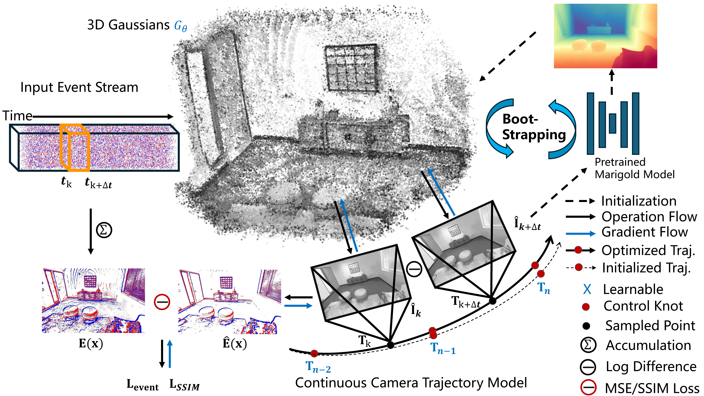
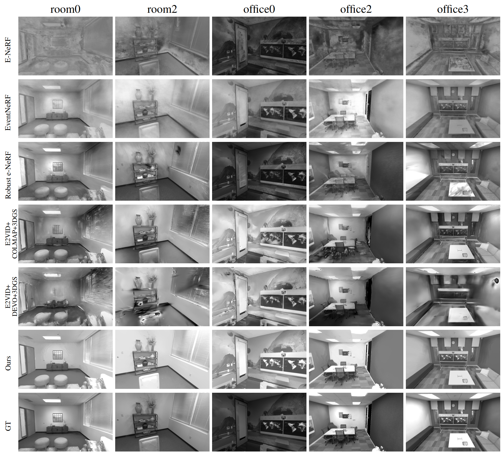
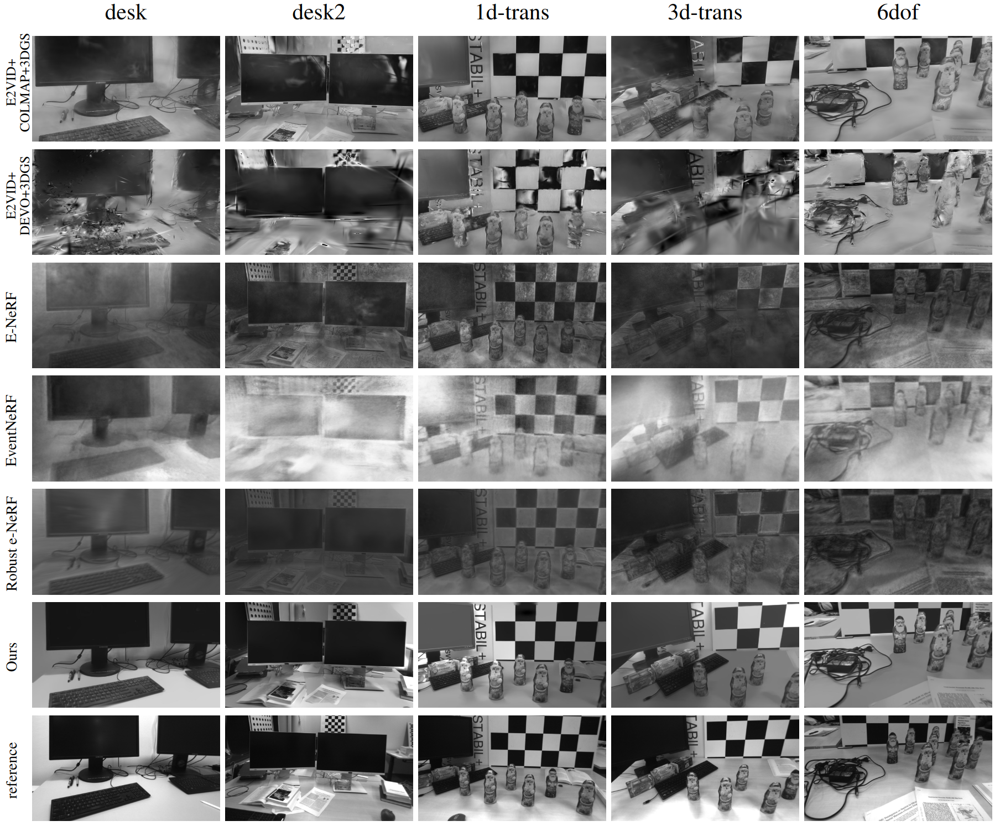
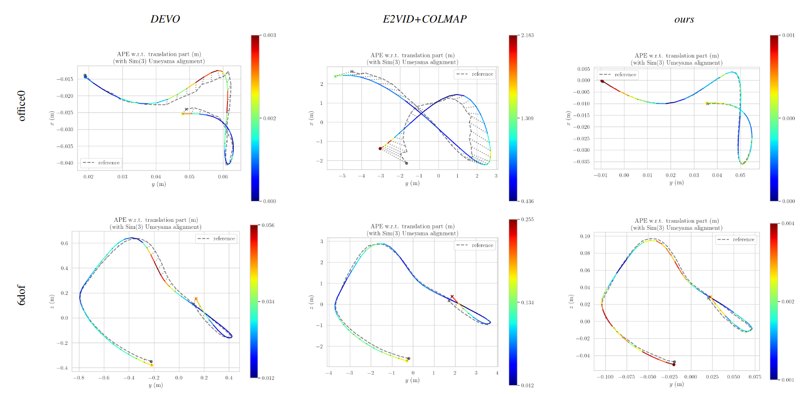

<h1 align="center">UEGS-SLAM: Uncertainty-Aware Event Gaussian Splatting SLAM</h1>
<p align="center">
    Jun Wang<sup>1</sup> &emsp;&emsp;
    Changqing Su<sup>2</sup> &emsp;&emsp;
    Zhen Cheng<sup>3</sup> &emsp;&emsp;
    Bo Xiong<sup>2*</sup> &emsp;&emsp;
    Yu Wang<sup>1*</sup>
</p>


<p align="center">
  <sup>*</sup> denotes corresponding author.
</p>

<p align="center">
    <sup>1</sup>Beijing Technology and Business University &emsp;&emsp;
    <sup>2</sup>Peking University &emsp;&emsp;
    <sup>3</sup>Tsinghua University &emsp;&emsp;
</p>

<hr>


> This repository contains the implementation of "UEGS-SLAM: Uncertainty-Aware Event Gaussian Splatting SLAM".

## 📋 Overview

<p align="center">
    
</p>

<div>
UEGS-SLAM partitions the incoming event stream into windows and represents the camera trajectory
continuously. Event supervision compares accumulated events with the log-intensity difference of
Gaussian renderings at two timestamps. The system learns per-Gaussian uncertainty for event-weighted
tracking and mapping, calibrates a monocular depth prior, and uses reliability-aware Gaussian
maintenance to limit the influence of poorly constrained map elements.
</div>

## 📋 Qualitative evaluation of novel view image synthesis on synthetic dataset.

<p align="center">
    
</p>

## 📋 Qualitative evaluation of novel view image synthesis on real dataset. 

<p align="center">
    
</p>

## 📋 Representative trajectory comparison

<p align="center">
    
</p>

## QuickStart
### 1. Installation
In the path where your want to store code, enter the following terminal command:

```bash
conda create -n uegs python=3.10
conda activate uegs
conda install -c "nvidia/label/cuda-11.8.0" cuda-toolkit # install CUDA toolkit
# Install the pytorch first (Please check the cuda version)
conda install pytorch torchvision torchaudio pytorch-cuda=11.8 -c pytorch -c nvidia

pip install -r requirements.txt

pip install ninja git+https://github.com/NVlabs/tiny-cuda-nn/#subdirectory=bindings/torch

pip install h5py hdf5plugin scikit-learn jaxtyping kornia

pip install -U  "huggingface-hub<0.26.0"
pip install pytorch_msssim
pip install tyro
pip install diffusers==0.27.1
pip install accelerate
pip install -U "transformers<=4.48.1"
```

### 2. Download Weights and Datasets
You can download pretrained weight of Marigold and datasets (Replica, pre-processed TUMVIE) by clicking this [link](https://westlakeu-my.sharepoint.com/:f:/g/personal/cvgl_westlake_edu_cn/EooEsF6LJPJHnEqbTYo4qO0B4-dlbznGZlLy9BDLPAx_og?e=wmqeFP). 

```bash
# unzip files
tar -xvf xxx.tar
```


### 3. Running demo
Before that, need to modify the `depthEst_pretrained_model_path` and `data:datadir`
```bash
python main.py --config configs/SimuEvent/replica_room0.yaml
```

### 4. Metrics Calculation

- NVS Performance
```bash
cd metrics/event_nerf
sh auto_single.sh [PATH_TO_IMG_EVAL] est gt 
```

- Pose Accuracy

    - install evo, `pip install evo`
    - run:
    ```bash
    cd [PATH_TO_EXPERIMENT]/global_BA
    evo_ape kitti [EST_PATH_NAME] [GT_PATH_NAME] --align -as
    ```

### 5. Dataset Format

**Our Replica(event) dataset** format is described as follows. It is recommended that you organize your custom datasets in this format if you want to run our method on **your own datasets**.

```
<dataset_name>              # e.g. room0
├── poses_ts.txt
├── traj.txt
├── images
    ├── frame000100.jpg   
    ├── frame000150.jpg
    ├── frame000200.jpg
    ...
├── event_threshold_0.1
    ├── gray_events_data.npy
```

- traj.txt format
```
r11 r12 r13 r14 r21 r22 r23 r24 r31 r32 r33 r34 r41 r42 r43 r44
```
r is transformation matrix (4*4).

## Citation

If you use this repository, please cite "UEGS-SLAM: Uncertainty-Aware Event Gaussian Splatting SLAM"
by Jun Wang, Changqing Su, Zhen Cheng, Bo Xiong, and Yu Wang. Publication details will be added
when available.

## Acknowledgments

This project builds on publicly released event-based Gaussian SLAM code by Jian Huang, Chengrui Dong, Xuanhua Chen, and Peidong Liu ([paper](https://arxiv.org/abs/2410.08107)). It also uses [gsplat](https://github.com/nerfstudio-project/gsplat), [Co-SLAM](https://github.com/HengyiWang/Co-SLAM), [E-NeRF](https://github.com/knelk/enerf), [EventNeRF](https://github.com/r00tman/EventNeRF), [BAD-Gaussians](https://github.com/WU-CVGL/BAD-Gaussians), [Marigold](https://github.com/prs-eth/Marigold), [Diffusers](https://github.com/huggingface/diffusers), and [PyPose](https://github.com/pypose/pypose). We thank the contributors to these projects.
